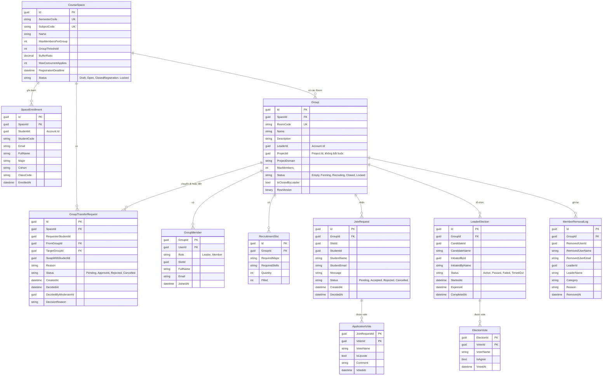
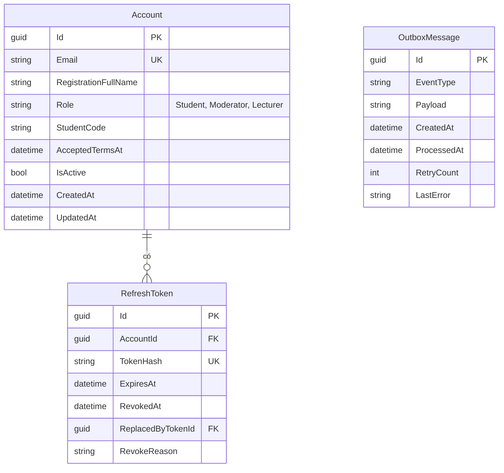
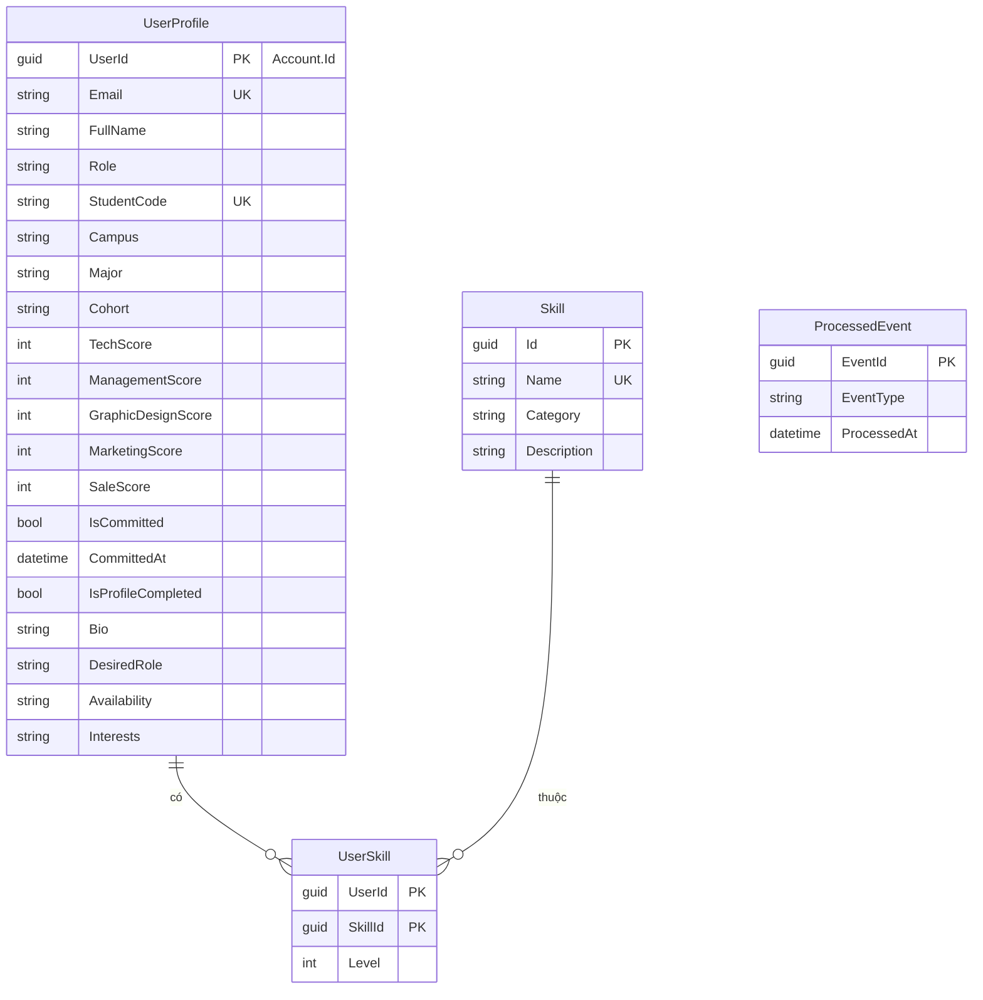
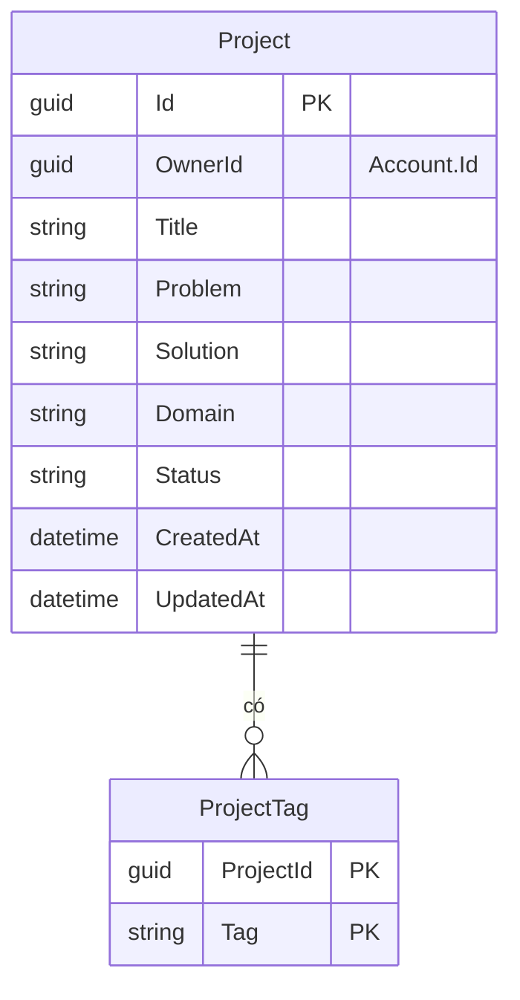
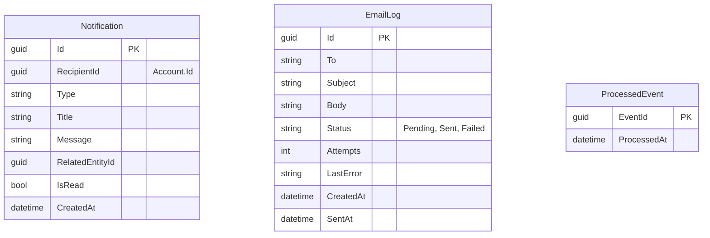
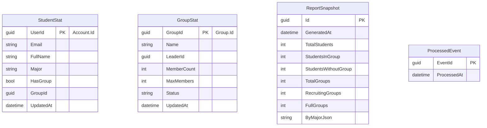

# ERD theo từng service

Mỗi service có database riêng. Quan hệ giữa các database chỉ là ID logic, không có khóa ngoại: `UserId`, `StudentId`, `LeaderId` đều là `Account.Id` do Auth Service tạo. Vì vậy mỗi service được vẽ thành một sơ đồ riêng.

## ExeGroupDb (Group Service)

## ExeAuthDb (Auth Service)

## ExeUserDb (User Service)

## ExeProjectDb (Project Service)

## ExeNotificationDb (Notification Service)

## ExeReportDb (Report Service)

Dữ liệu ở đây được dựng lại từ event, không truy vấn database của service khác.

