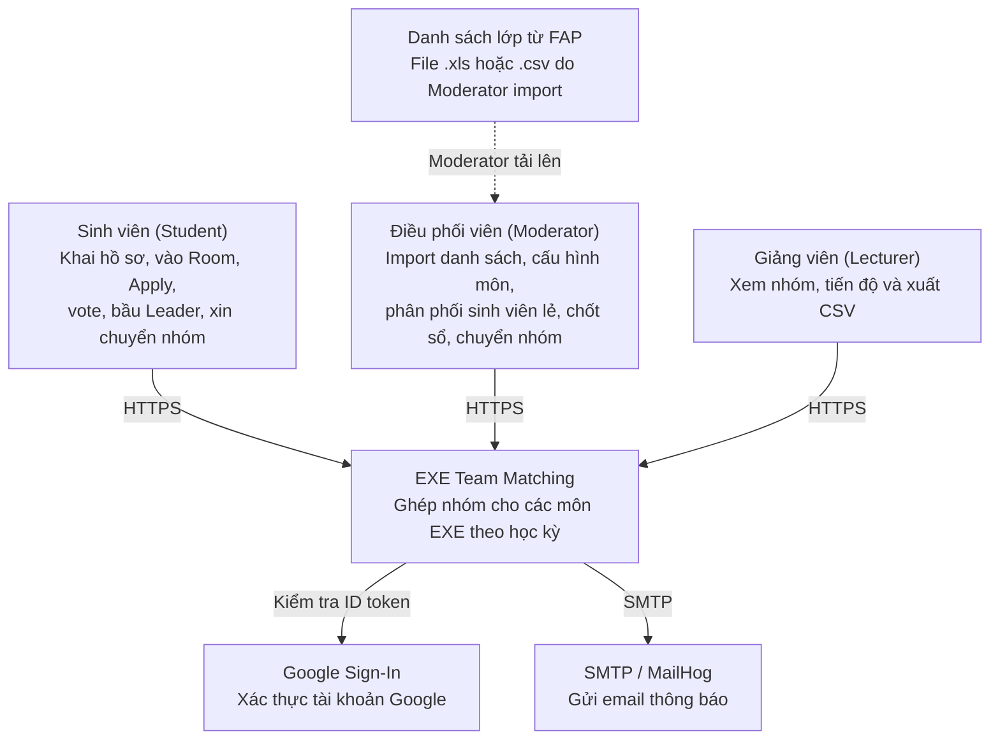
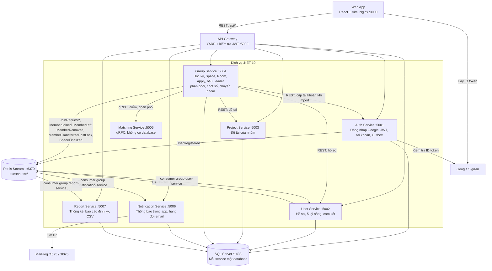

# Kiến trúc EXE Team Matching

Sơ đồ kiến trúc theo C4 Model. Thiết kế dữ liệu của từng service nằm ở [ERD.md](ERD.md).

## C0: System Context

## C1: Container

## Luồng đăng nhập

1. Web App lấy ID token từ Google Sign-In.
2. Web App gọi `POST /api/auth/google`.
3. Auth Service kiểm tra chữ ký, hạn và audience của token với Google.
4. Auth Service tìm email trong các tài khoản đã tạo khi import danh sách, so sánh không phân biệt hoa thường.
5. Có tài khoản thì cấp JWT và refresh token. Không có thì trả `403 NOT_IN_FAP_LIST`.
