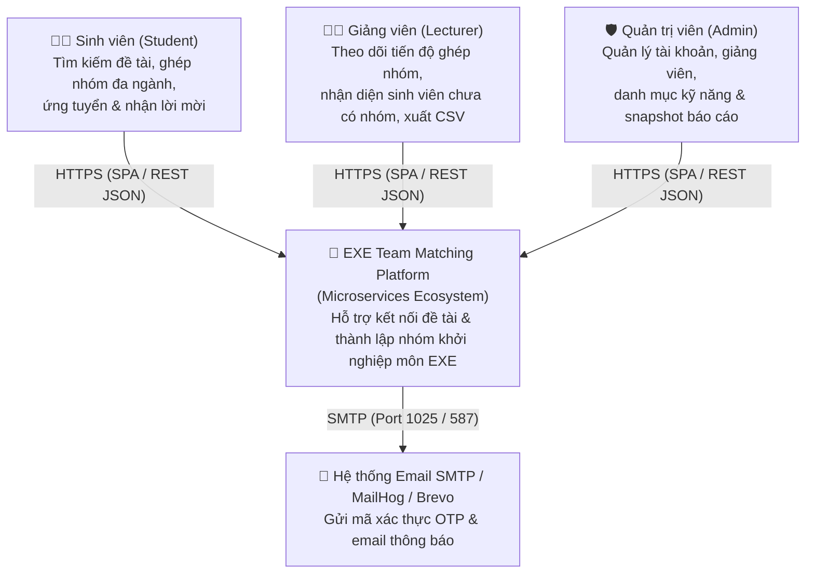
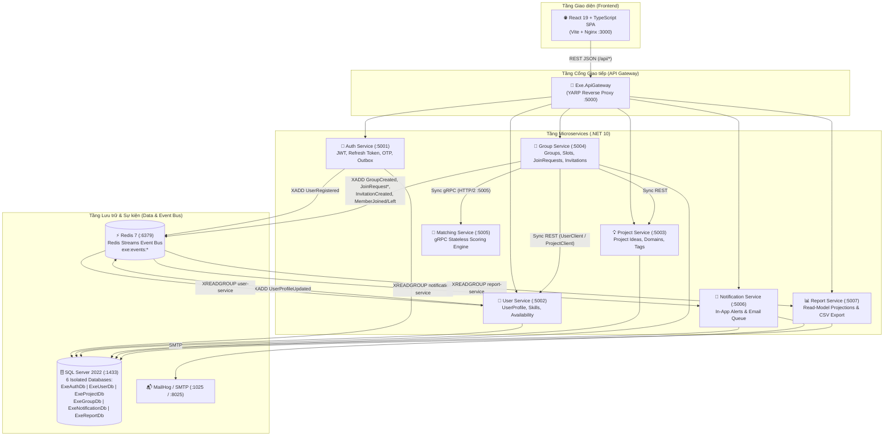

# Kiến trúc Hệ thống EXE Team Matching (C0 & C1)

Tài liệu sơ đồ kiến trúc C4 Model (Mức C0 — System Context và Mức C1 — Container Diagram) cho hệ thống **EXE Team Matching**.

---

## 1. Mức C0 — System Context Diagram

---

## 2. Mức C1 — Container & Communication Diagram

