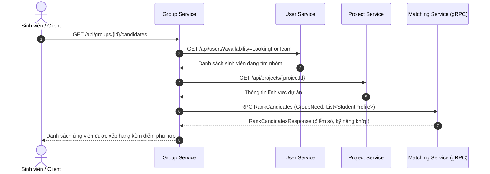

# Hướng dẫn Tích hợp Liên Dịch vụ (Service-to-Service Integration Guide)

> **Tài liệu Hướng dẫn Tích hợp dành cho API Gateway, Group Service, Project Service, Matching Service, Notification Service và Report Service**
> Dự án: EXE Team Matching System (PRN232 Final Assignment)

---

## 1. TÍCH HỢP QUA API GATEWAY (YARP REVERSE PROXY)

API Gateway (`Exe.ApiGateway` — Cổng 5000) đóng vai trò Reverse Proxy định tuyến và kiểm tra tính hợp lệ của JWT token trước khi chuyển tiếp request vào mạng nội bộ.

### Cấu hình định tuyến YARP tham khảo (`appsettings.json` của Gateway):

```json
{
  "ReverseProxy": {
    "Routes": {
      "auth-route": {
        "ClusterId": "auth-cluster",
        "Match": {
          "Path": "/api/auth/{**catch-all}"
        }
      },
      "user-route": {
        "ClusterId": "user-cluster",
        "Match": {
          "Path": "/api/users/{**catch-all}"
        }
      },
      "skills-route": {
        "ClusterId": "user-cluster",
        "Match": {
          "Path": "/api/skills/{**catch-all}"
        }
      }
    },
    "Clusters": {
      "auth-cluster": {
        "Destinations": {
          "destination1": {
            "Address": "http://auth-service:8080"
          }
        }
      },
      "user-cluster": {
        "Destinations": {
          "destination1": {
            "Address": "http://user-service:8080"
          }
        }
      }
    }
  }
}
```

---

## 2. TÍCH HỢP GROUP SERVICE → USER SERVICE (REST CALLS)

Group Service cần thông tin hồ sơ của sinh viên để hiển thị danh sách thành viên nhóm, duyệt đơn xin vào nhóm, và chuẩn bị dữ liệu gửi sang Matching Service qua gRPC.

### Phương thức tương tác: Typed `HttpClient`

Group Service nên tạo interface `IUserClient` trong project `Group.Services/Clients/` và cấu hình Resilience Handler:

```csharp
public interface IUserClient
{
    Task<UserProfileResponse?> GetUserProfileAsync(Guid userId, CancellationToken ct = default);
    Task<IReadOnlyList<UserProfileResponse>> GetBatchProfilesAsync(IEnumerable<Guid> userIds, CancellationToken ct = default);
}
```

### Triển khai Token Delegation (Ủy quyền Bearer Token):
Khi người dùng gọi `GET /api/groups/{id}`, Group Service nhận HTTP Request kèm header `Authorization: Bearer <jwt>`. Group Service phải **chuyển tiếp nguyên vẹn** header này sang User Service:

```csharp
public class UserClient : IUserClient
{
    private readonly HttpClient _httpClient;
    private readonly IHttpContextAccessor _httpContextAccessor;

    public UserClient(HttpClient httpClient, IHttpContextAccessor httpContextAccessor)
    {
        _httpClient = httpClient;
        _httpContextAccessor = httpContextAccessor;
    }

    public async Task<UserProfileResponse?> GetUserProfileAsync(Guid userId, CancellationToken ct = default)
    {
        AttachBearerToken();
        var response = await _httpClient.GetAsync($"/api/users/{userId}", ct);
        if (response.StatusCode == HttpStatusCode.NotFound) return null;
        response.EnsureSuccessStatusCode();
        return await response.Content.ReadFromJsonAsync<UserProfileResponse>(cancellationToken: ct);
    }

    public async Task<IReadOnlyList<UserProfileResponse>> GetBatchProfilesAsync(IEnumerable<Guid> userIds, CancellationToken ct = default)
    {
        AttachBearerToken();
        var response = await _httpClient.PostAsJsonAsync("/api/users/batch", new { userIds }, ct);
        response.EnsureSuccessStatusCode();
        return await response.Content.ReadFromJsonAsync<IReadOnlyList<UserProfileResponse>>(cancellationToken: ct) ?? [];
    }

    private void AttachBearerToken()
    {
        var authHeader = _httpContextAccessor.HttpContext?.Request.Headers["Authorization"].FirstOrDefault();
        if (!string.IsNullOrWhiteSpace(authHeader))
        {
            _httpClient.DefaultRequestHeaders.Remove("Authorization");
            _httpClient.DefaultRequestHeaders.Add("Authorization", authHeader);
        }
    }
}
```

### Đăng ký trong `Group.API/Program.cs`:
```csharp
builder.Services.AddHttpClient<IUserClient, UserClient>(client =>
{
    client.BaseAddress = new Uri(builder.Configuration["Services:User"] ?? "http://user-service:8080");
    client.Timeout = TimeSpan.FromSeconds(5);
}).AddStandardResilienceHandler();
```

---

## 3. TÍCH HỢP VỚI MATCHING SERVICE (gRPC)

Theo kiến trúc CLAUDE.md mục 8:
- Matching Service là dịch vụ **stateless, không có database, không gọi ra ngoài**.
- Group Service gom dữ liệu từ **User Service** (kỹ năng, chuyên ngành, mong muốn) và **Project Service** (lĩnh vực dự án), chuyển đổi thành message protobuf `StudentProfile` và `GroupNeed`, sau đó gọi Matching qua gRPC.



---

## 4. TÍCH HỢP NOTIFICATION VÀ REPORT SERVICE (REDIS STREAMS CONSUMERS)

Cả Notification Service và Report Service đều cần lắng nghe sự kiện `UserRegisteredEvent` khi có tài khoản mới tạo:
1. **Notification Service:** Nhận event và tạo thông báo chào mừng / gửi email qua MailHog (SMTP).
2. **Report Service:** Nhận event và lưu vào bảng thống kê sinh viên (`StudentStat`).

### Hướng dẫn cài đặt Consumer:
1. Thêm reference tới `Exe.Contracts` và `Exe.BuildingBlocks`.
2. Tạo Worker kế thừa `BackgroundService`.
3. Khai báo Consumer Group riêng:
   - Notification Service: `notification-service`
   - Report Service: `report-service`
4. Quét stream `exe:events:UserRegistered` bằng `XREADGROUP`.
5. Kiểm tra bảng `ProcessedEvents` cục bộ của service để đảm bảo tính Idempotent.
6. Commit transaction nghiệp vụ trước khi gọi `XACK`.
